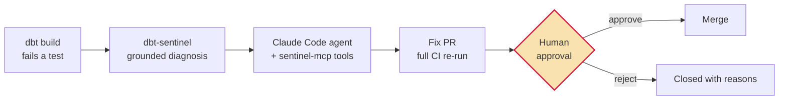

# sentinel-agent-loop

**An agentic data-quality workflow with a human approval gate.** When a dbt test
fails, an AI agent diagnoses the root cause from grounded warehouse evidence,
proposes a fix as a pull request — and a human decides whether it merges.
Nothing autonomous ever touches `main`.



Reference implementation targeting
[taxi-analytics-pipeline](https://github.com/qraza/taxi-analytics-pipeline),
built from two reusable components:

- [**dbt-sentinel**](https://github.com/qraza/dbt-sentinel) ([PyPI](https://pypi.org/project/dbt-sentinel/)) —
  joins `run_results.json` + `manifest.json`, samples offending rows from the
  warehouse, and produces an evidence-cited diagnosis.
- [**sentinel-mcp**](https://github.com/qraza/sentinel-mcp) — exposes those
  capabilities as MCP tools (`explain_failure`, `sample_failing_rows`,
  `model_lineage`, `test_history`, …) so the agent verifies against real
  warehouse state instead of guessing.

## It ran against a real incident

This isn't only a seeded demo. A units regression was merged to the target
repo's `main` under an innocuous commit message
([PR #7](https://github.com/qraza/taxi-analytics-pipeline/pull/7) — the
`60 *` minutes→hours factor silently dropped from `avg_speed_mph`, shrinking
every speed 60×). The loop, run in its normal scheduled mode:

1. built `main`, and the distribution guard failed (median speed 0.16 mph vs
   a floor of 3);
2. attached sentinel's evidence-cited diagnosis as a run artifact;
3. had the agent verify the diagnosis through sentinel-mcp, restore the
   conversion, and prove the fix with the full check suite;
4. opened [PR #9](https://github.com/qraza/taxi-analytics-pipeline/pull/9)
   — a one-line fix with the evidence chain in the description — which sat
   blocked until a human approved it, and healed `main` on merge.

All runs are public:
[workflow history](https://github.com/qraza/sentinel-agent-loop/actions/workflows/dq-loop.yml).

<!-- screenshots: docs/img/blocked-merge.png (Merging is blocked / Review
     required) and docs/img/run-summary.png (Fix proposed, awaiting human
     approval) -->

## Why the governance controls exist

| Control | What it prevents |
|---|---|
| **Grounding via sentinel-mcp** | Hallucinated diagnoses — every claim must be reproducible from `run_results.json` and sampled rows |
| **Root-cause rule** | The lazy fix: widening a test's bounds until it passes. The agent may only change a test if it shows the test itself encodes the error |
| **Tool allowlist (not denylist)** | Unknown capabilities are denied by default; workflows, `.env*`, and CI config are explicitly unwritable |
| **Agent holds no GitHub credentials** | Exfiltration or privilege escalation via the GitHub API. The agent writes `pr_title.txt` / `pr_body.md`; a deterministic workflow step holding a PAT scoped to one repo opens the PR |
| **Full CI re-run in the PR** | "Works on the agent's machine" — ruff, pytest, and `dbt build` must all pass before a human ever looks |
| **Branch protection on `main`** | Autonomous merges. The approval gate is enforced by the platform, not by prompt engineering |

The credential split was learned, not designed up front: in an early run the
agent, granted `gh`, hit a token that couldn't create PRs — and stopped,
explicitly declining to try workarounds. The refactor made that boundary
structural: the agent now has no GitHub API access at all.

One honest limitation: this is a single-maintainer repo, and the PAT acts as
its owner, so GitHub treats the owner as the PR author and each merge uses an
audited admin bypass after manual review. In a team — or with a dedicated
GitHub App identity for the loop — the approval binds fully with no bypass.

## Guard-test design: distributions, not rows

The target repo's original speed test only bounded rows from above
(`> 80 mph`). A first attempt at a lower bound (`< 1 mph`) false-positived on
real data: NYC gridlock legitimately produces sub-1 mph crawls. But a units
bug doesn't create slow *rows* — it shifts the *entire distribution*. The
shipped guard therefore asserts the **median** stays plausible
(`demo/prereq_add_median_guard.patch`): outlier crawls can't trip it; a
systemic 60× shrink always will. Fitting, given the original historical bug
in this project survived because its test encoded the same units mistake.

## Reproducible demo mode

For a repeatable demonstration without touching `main`: run the workflow with
the **demo checkbox** ticked. It applies `demo/break_avg_speed.patch` (the
same historical units bug) on a working branch, and the loop runs identically
from there. Note the resulting PR's net diff vs `main` is empty — the fix
exactly reverts the seed on the same branch — so the per-commit view tells
the story. The real-incident mode above is the better showcase.

## Repo layout

```
.github/workflows/dq-loop.yml        the loop: detect -> diagnose -> propose
prompts/fix_prompt.md                agent instructions with governance rules baked in
demo/break_avg_speed.patch           seeds the units regression on a branch (demo mode)
demo/prereq_add_median_guard.patch   the distribution-level guard test (merged to the target repo)
docs/SETUP.md                        secrets, PAT scopes, branch protection
```

## Setup

See [docs/SETUP.md](docs/SETUP.md). Short version: two secrets on this repo
(`CLAUDE_CODE_OAUTH_TOKEN`, `ANTHROPIC_API_KEY`) plus `TARGET_REPO_TOKEN` — a
fine-grained PAT scoped to the target repo only (Contents + Pull requests) —
the Claude Code GitHub App installed on both repos, and branch protection on
the target's `main` requiring one review and passing CI. The gate is the
platform's, not the prompt's.
