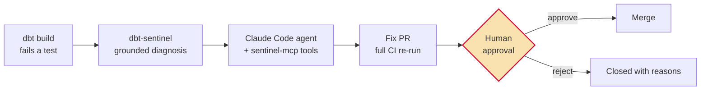

# sentinel-agent-loop

**An agentic data-quality workflow with a human approval gate.** When a dbt test
fails, an AI agent diagnoses the root cause from grounded warehouse evidence,
proposes a fix as a pull request — and a human decides whether it merges.
Nothing autonomous ever touches `main`.



Reference implementation targeting
[taxi-analytics-pipeline](https://github.com/qraza/taxi-analytics-pipeline),
built from two reusable components:

- [**dbt-sentinel**](https://github.com/qraza/dbt-sentinel) ([PyPI](https://pypi.org/project/dbt-sentinel/)) —
  joins `run_results.json` + `manifest.json`, samples offending rows from the
  warehouse, and produces an evidence-cited diagnosis.
- [**sentinel-mcp**](https://github.com/qraza/sentinel-mcp) — exposes those
  capabilities as MCP tools (`explain_failure`, `sample_failing_rows`,
  `model_lineage`, `test_history`, …) so the agent verifies against real
  warehouse state instead of guessing.

## Why the governance controls exist

| Control | What it prevents |
|---|---|
| **Grounding via sentinel-mcp** | Hallucinated diagnoses — every claim must be reproducible from `run_results.json` and sampled rows |
| **Root-cause rule** | The lazy fix: widening a test's bounds until it passes. The agent may only change a test if it shows the test itself encodes the error |
| **Tool allowlist (not denylist)** | Unknown capabilities are denied by default; workflows, `.env*`, and CI config are explicitly unwritable |
| **Full CI re-run in the PR** | "Works on the agent's machine" — ruff, pytest, and `dbt build` must all pass before a human ever looks |
| **Branch protection on `main`** | Autonomous merges. The approval gate is enforced by the platform, not by prompt engineering |

This mirrors the pattern I use in production FP&A automation: agents draft,
humans approve, and the boundary is enforced by infrastructure.

## Watch it run

The failure is seeded, not prayed for. `demo/break_avg_speed.patch`
reintroduces a real historical bug from the target project — dropping the
`60 *` minutes→hours factor from `avg_speed_mph`, so every speed silently
shrinks by 60×.

The bug has a second lesson baked in: the original incident happened because
the AI-written test encoded the same mistake. An upper bound alone can't catch
a uniform shrink — so the guard test asserts a **plausibility floor** too
(`demo/prereq_add_speed_floor.patch`, now part of the target repo's test
suite).

Run the demo:

1. Actions → **Data-quality loop** → *Run workflow* → tick **demo_break**.
2. `dbt build` goes red; sentinel's diagnosis is attached as a run artifact.
3. The agent verifies the diagnosis through sentinel-mcp, restores the units
   factor, re-runs the full suite, and opens a PR citing its evidence.
4. The PR sits at the human gate until approved.

<!-- TODO: 60-90s GIF of the run here -->

## Repo layout

```
.github/workflows/dq-loop.yml   the loop: detect -> diagnose -> propose
prompts/fix_prompt.md           agent instructions with governance rules baked in
demo/break_avg_speed.patch      seeds the units regression (reproducible failure)
demo/prereq_add_speed_floor.patch  one-time guard-test upgrade for the target repo
docs/SETUP.md                   secrets, PAT scopes, branch protection
```

## Setup

See [docs/SETUP.md](docs/SETUP.md). Short version: two secrets
(`CLAUDE_CODE_OAUTH_TOKEN`, `TARGET_REPO_TOKEN` — a fine-grained PAT scoped to
the target repo), one `ANTHROPIC_API_KEY` for sentinel's diagnosis step, and
branch protection on the target repo's `main` requiring one review. The gate
is the platform's, not the prompt's.
